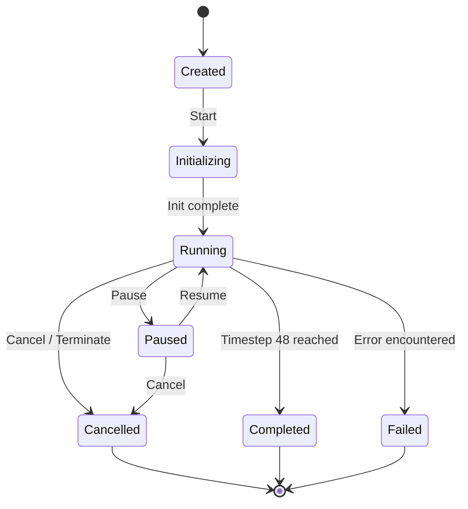

# Phase 6 Implementation Plan: Asynchronous Disaster Simulation Engine

This document outlines the detailed vertical chunk execution strategy for Phase 6. The goal is to build an interactive, production-grade Disaster Simulation Engine executing cascading logic over a 48-hour timeline, broadcasting states via WebSockets, and updating tactical control dashboards.

---

## State Machine
The simulation operates under a strict progression state machine:
`Created` ➔ `Initializing` ➔ `Running` ➔ `Paused` ➔ `Completed`
*Failed* or *Cancelled* transitions route cleanly to terminal states.



---

# Chunk 1: Database Collection & Basic Creation API (`simulations`)

## Objective
Establish the database models, indices, and Pydantic validation schemas for the `simulations` collection, creating a basic route to initialize simulation records.

## Why this chunk comes now
Lays the persistence foundation for all subsequent simulation states and progression steps.

## Features covered
* Inception of the `simulations` collection.
* POST route creating a blank simulation template in `Created` state.

## Backend work
* **Pydantic Schemas**: Define `SimulationCreate` and `SimulationResponse` in `backend/app/models/schemas/simulation.py`.
* **FastAPI Router**: Create [simulations.py](file:///d:/Projects/Personal/AI-Disaster-Orchastrator/backend/app/api/v1/endpoints/simulations.py) exposing `POST /api/v1/simulations/`.
* **State Manager**: Initialize state mapping to `"Created"`.

## Frontend work
* **Route**: Prepare skeleton route at `/admin/simulation/page.tsx` displaying the simulation workspace dashboard.

## API Integration
* **Endpoint**: `POST /api/v1/simulations`
* **Request Payload**:
  ```json
  {
    "scenarioId": "60a4f5f5f5f5f5f5f5f5f50b",
    "name": "Cyclone Odisha Active Exercise"
  }
  ```
* **Response Payload (201 Created)**: Returns base metadata, scenario reference, and `status: "Created"`.

## WebSocket Integration
* None (REST verification).

## Database work
* **Collections**: Initialize `simulations`.
* **Indexes**: Compound index `{ "createdBy": 1, "createdAt": -1 }`.

## ML Integration
* Extract configuration attributes from referencing `scenarios` collection document to map geographical indices.

---

# Chunk 2: Simulation Setup UI Wizard (`/admin/simulation/new`)

## Objective
Build the Next.js setup screen letting emergency coordinators select scenario templates and initiate new simulation exercises.

## Why this chunk comes now
Provides operators the entry point to instantiate simulation runs in the database.

## Features covered
* Interactive wizard selection matching saved scenarios.
* Redirections on validation success.

## Backend work
* Expose active scenario lookups matching list requests inside the admin router.

## Frontend work
* **Route**: `/admin/simulation/new/page.tsx`
* **UI Modules**: Scenario picker dropdown, custom validation error messages, loading state skeleton templates.

## API Integration
* Fetch list filters from `/api/v1/scenarios`.
* Integrate POST request mapping payload to `/api/v1/simulations`.

## WebSocket Integration
* None.

## Database work
* Query `scenarios` collection; save to `simulations` collection.

## ML Integration
* None (Configuration loading).

---

# Chunk 3: Simulation Control Manager & State Operations

## Objective
Establish the execution state controllers (`/start`, `/pause`, `/resume`, `/cancel`) on the backend, tracking transitions in the database.

## Why this chunk comes now
Wires the core command signals before running the time-step engines.

## Features covered
* Actions control endpoints.
* State machine validator checks.

## Backend work
* **Services**: Implement `SimulationManager` state transitions validations.
* **Endpoints**: Expose `POST /api/v1/simulations/{id}/start`, `/pause`, `/resume`, `/cancel` route paths.

## Frontend work
* **UI Modules**: Status display badge (Created, Running, Paused), play/pause controller bar buttons, confirm cancellation alerts.

## API Integration
* Integrate action triggers returning the updated state.

## WebSocket Integration
* None.

## Database work
* Save state status logs and `updatedAt` timestamps in `simulations`.
* Record `EXECUTE_SIMULATION` actions to `admin_audit_logs`.

## ML Integration
* None.

---

# Chunk 4: Timeline Progression Engine & Hour 0 Landfall

## Objective
Develop the core timeline progression loop, executing the baseline GBDT predictions for the initial Hour 0 landfall.

## Why this chunk comes now
Fires the first physical metrics step (deaths, damage) from which all subsequent cascade failures propagate.

## Features covered
* Timeline engine timestep calculations.
* Hour 0 landfall impact initialization.

## Backend work
* **Services**: Build `TimelineEngine`. Run first prediction queries against ML microservice parameters.
* **Calculation**: Set baseline casualties, affected counts, and default resource requirements.

## Frontend work
* **UI Modules**: Timestep progression progress bars, timeline slider nodes (`Hour 0`, `Hour 6`, `Hour 12`, `Hour 24`, `Hour 48`).

## API Integration
* `GET /api/v1/simulations/{id}/steps/0` returning landfall estimates.

## WebSocket Integration
* None.

## Database work
* Embed `timesteps` array inside target simulation document, initializing elements at index `0`.

## ML Integration
* Calls ML microservice `POST /predict/` executing GBDT regressions for the active scenario coordinates, hazard type, and intensity.

---

# Chunk 5: WebSocket Gateway & Heartbeat Protocol

## Objective
Establish the real-time WebSocket communication layer on the backend to stream live progress updates, logs, and completion signals to the browser.

## Why this chunk comes now
Enables live broadcast capabilities before starting the asynchronous cascading rules steps.

## Features covered
* WebSocket server lifecycle management.
* Reconnect and ping/pong heartbeats.

## Backend work
* **Endpoints**: Mount `/api/v1/simulations/{id}/ws` WebSocket handler.
* **Authentication**: Verify JWT Bearer authorization passed as URL token parameters.

## Frontend work
* Create a custom hook `useSimulationWebSocket` managing connections, parsing JSON frames, and handling offline re-connections.

## API Integration
* Dynamic streaming socket events.

## WebSocket Integration
* Lifecycle events: `CONNECTION_ESTABLISHED`, `STEP_PROGRESS`, `PAUSED`, `COMPLETED`, `HEARTBEAT`.

## Database work
* Read socket connection registries.

## ML Integration
* None.

---

# Chunk 6: Cascade Rules Engine & Infrastructure State Framework

## Objective
Build the cascading rules parser and infrastructure status tracking framework, defining initial status levels for key lifelines.

## Why this chunk comes now
Allows the system to model sequential utility and transit corridor failures.

## Features covered
* Infrastructure states definition tracking (Operational, Degraded, Critical, Failed, Recovery).
* Conditional rules mapper executing cascade configurations.

## Backend work
* **Services**: Implement `CascadeRulesEngine` and `InfrastructureStateEngine`.
* **Attributes**: Setup status trackers for Power Grid, Road Network, Hospitals, Water Supply, and Communication systems.

## Frontend work
* **UI Modules**: Status grid component rendering utility health icons (Grid, Road, Signal, Hospital) with color classifications.

## API Integration
* Expose infrastructure state matrices in step responses.

## WebSocket Integration
* Broadcast initial infrastructure updates.

## Database work
* Save infrastructure matrices inside active simulation documents.

## ML Integration
* Map severity thresholds calculated by LightGBM to configure initial infrastructure degradation indices.

---

# Chunk 7: Timeline Step 1 (Hour 6: Primary Grid Cascades)

## Objective
Execute progression to Hour 6, triggering primary utility failures (power outages) and updating EOC alerts.

## Why this chunk comes now
Steps the model into temporal propagation, assessing secondary failures from the landfall.

## Features covered
* Hour 6 progression step logic.
* Power grid outage cascading impacts.

## Backend work
* **Simulation Runner**: Calculate Hour 6 parameters.
* **Cascade Rule**: Storm magnitude > threshold ➔ Power Grid Failed ➔ Communication Degraded, Water Supply Degraded.

## Frontend work
* **UI Modules**: Active progress animations transitioning to Hour 6, visual alert indicators mapping utilities failure warnings.

## API Integration
* Trigger progression step updates.

## WebSocket Integration
* Broadcast Hour 6 state packet.

## Database work
* Append timestep parameters for index `1` (Hour 6) to simulations collection.

## ML Integration
* Incorporate KNN historical analogs similarity outputs to establish decay rates for critical infrastructure.

---

# Chunk 8: Timeline Step 2 (Hour 12: Transportation Corridors)

## Objective
Execute progression to Hour 12, triggering transit road networks blockages and emergency shelter degradation.

## Why this chunk comes now
Introduces accessibility failures affecting resource deliveries.

## Features covered
* Hour 12 step parameters computations.
* Road blockage and transit failure cascades.

## Backend work
* **Cascade Rule**: Heavy flood levels or cyclone duration > 12h ➔ Road Network Failed.
* **Cascade Rule**: Road Network Failed + Communication Degraded ➔ Emergency Shelters Degraded (logistics supply routes blocked).

## Frontend work
* **UI Modules**: Transit status maps, visual alerts highlighting road block corridors.

## API Integration
* Trigger progression to Hour 12.

## WebSocket Integration
* Broadcast Hour 12 state packet.

## Database work
* Append timestep parameters for index `2` (Hour 12) to simulations collection.

## ML Integration
* Dynamic recalculation of logistics multipliers based on regional risk clusters indexes.

---

# Chunk 9: Timeline Step 3 (Hour 24: Healthcare Stress)

## Objective
Execute progression to Hour 24, triggering hospital overload thresholds and secondary medical casualty multipliers.

## Why this chunk comes now
Models secondary health and utility stress occurring 24 hours after landfall.

## Features covered
* Hour 24 step computations.
* Medical system overloading cascades.

## Backend work
* **Cascade Rule**: Power Grid Failed + Road Network Failed ➔ Hospital Overload (Critical status).
* **Casualty Multiplier**: Hospital Overload ➔ Increase expected deaths metrics by $+15\%$ for subsequent timesteps.

## Frontend work
* **UI Modules**: Hospital capacity trackers, casualty increment charts.

## API Integration
* Trigger progression to Hour 24.

## WebSocket Integration
* Broadcast Hour 24 state packet.

## Database work
* Append timestep parameters for index `3` (Hour 24) to simulations collection.

## ML Integration
* Recalculates expected casualty outcomes, integrating health stress parameters into ML inference pipelines.

---

# Chunk 10: Timeline Step 4 (Hour 48 & Beyond: Recovery Thresholds)

## Objective
Execute progression to Hour 48, calculating utility restorations, infrastructure recovery status parameters, and concluding the exercise timeline.

## Why this chunk comes now
Closes the temporal loop, moving states from crisis progression into recovery.

## Features covered
* Hour 48 step parameters.
* Concluding simulation states mapping to `Completed`.

## Backend work
* **Cascade Rule**: Time elapsed = 48h ➔ Trigger utility recovery progression coefficients (Operational indices improve).
* Transition state status to `Completed`.

## Frontend work
* **UI Modules**: Exercise summary panel, overall recovery duration forecast metrics.

## API Integration
* Trigger final step; close progression capabilities.

## WebSocket Integration
* Broadcast simulation completion packets.

## Database work
* Save final timestep status matrix; update main simulation status to `Completed`.

## ML Integration
* Evaluate historical analog recovery periods from KNN search to estimate restoration timeline durations.

---

# Chunk 11: Real-time Playback Controls Dashboard Page

## Objective
Assemble the active tactical dashboard at `/admin/simulation/live` featuring temporal progress controls (play, pause, step-forward, terminate).

## Why this chunk comes now
Connects playback control signals to user panels.

## Features covered
* live playback dashboard interface.
* Real-time controls UI indicators.

## Frontend work
* **Route**: `/admin/simulation/live/page.tsx`
* **UI Modules**: Main operational layout, timeline navigation controls, state status flags, reset indicators.

## API Integration
* Connect playback controls to backend `/start`, `/pause`, `/resume`, `/cancel` APIs.

## WebSocket Integration
* Synchronize interface status checks with incoming WS events.

## Database work
* Write system logs audit records for playback actions.

## ML Integration
* None.

---

# Chunk 12: EOC Tactical Simulation Logs Panel

## Objective
Implement a real-time EOC log terminal widget in the live dashboard, parsing cascading rule triggers into status reports.

## Why this chunk comes now
Provides administrative operators with trace logs of all cascaded failures.

## Features covered
* Real-time EOC action logs component.

## Backend work
* **Services**: Build `EventLogger`.
* **Function**: Format logs strings dynamically (e.g. `[Hour 12] Power Failure triggers communication outage in Garissa`).

## Frontend work
* **UI Modules**: Streaming terminal window widget, priority-colored log messages (Red for failure, Amber for warning, Green for recovery).

## API Integration
* GET endpoints serving chronological historical simulation log lists.

## WebSocket Integration
* Stream log messages frame updates dynamically.

## Database work
* Embed logs lists inside active simulation collections documents.

## ML Integration
* None.

---

# Chunk 13: Resource Allocations & Planning Engine

## Objective
Integrate the EOC Resource Planning Engine, calculating logistics counts (ambulances, camps, medical teams) required at each timestep.

## Why this chunk comes now
Enables resource estimates to update dynamically as casualties change across steps.

## Features covered
* Dynamic resource requirement allocations.

## Backend work
* **Services**: Build `ResourceCalculator`.
* **Formulas**: Calculate resource needs (ambulances, generator grids, water volumes) dynamically based on current step casualty and affected predictions.

## Frontend work
* **UI Modules**: Tactical resources list panel showing expected resource line allocations per step.

## API Integration
* Include requirements schemas in step API payloads.

## WebSocket Integration
* Stream updated resource requirements lists.

## Database work
* Persistent updates of requirements states in simulations data records.

## ML Integration
* Dynamically feeds current GBDT prediction outputs (affected population, severity) to calculate required ambulances and camps counts.

---

# Chunk 14: Dynamic Stockpile Deficit Analyzer

## Objective
Build the resource stockpile deficit analysis, matching requirements against active EOC depot inventory metrics.

## Why this chunk comes now
Translates resource counts into operational alerts for logistical shortfalls.

## Features covered
* Stockpile deficit analysis dashboards.
* Alert indicators for severe shortages.

## Backend work
* **Services**: Build `DeficitAnalyzer`.
* **Logics**: Compare required resources against EOC warehouse stock registries. Mark alerts: Critical Shortage, Moderate Shortage, Sufficient.

## Frontend work
* **UI Modules**: Deficit alert badges, priority logistical recommendations sidebar.

## API Integration
* Expose deficit matrices in active simulation step configurations.

## WebSocket Integration
* Stream deficit alerts.

## Database work
* Query EOC inventory registers; save calculations inside simulation resource records.

## ML Integration
* None.

---

# Chunk 15: Regional Risk Vulnerability Comparisons

## Objective
Integrate regional risk clustering datasets to calibrate vulnerability indices and infrastructure decay rates.

## Why this chunk comes now
Enhances simulation accuracy using historical subregion risk weights.

## Features covered
* Subregion risk clustering metrics display.

## Backend work
* Query ordinal risk tier assignments from `regional_risk_clusters`.
* **Logic**: Apply risk coefficients to cascade rules (e.g. "Extreme Risk" subregions degrade 2x faster).

## Frontend work
* **UI Modules**: Vulnerability indicator badge, comparison tables mapping subregion hazards.

## API Integration
* None.

## WebSocket Integration
* None.

## Database work
* Read configurations from `regional_risk_clusters` collection.

## ML Integration
* Integrates regional risk matrices from the pre-fit K-Means clustering model to adapt infrastructure failure curves.

---

# Chunk 16: Dynamic Maps and Cascading Hazard Plots

## Objective
Create maps and chart visualizations on the dashboard showing cascading hazards progression.

## Why this chunk comes now
Provides coordinators with critical spatial-temporal situational awareness.

## Features covered
* Timestep metrics progression charts.

## Frontend work
* **UI Modules**: Recharts graphs mapping expected deaths/affected trends across hours, status grids representing infrastructure health metrics.

## API Integration
* Dynamic data bindings.

## WebSocket Integration
* Re-render chart graphs as steps progress.

## Database work
* None.

## ML Integration
* None.

---

# Chunk 17: Simulation History & Completed List Views

## Objective
Build the paginated historical simulations dashboard, allowing coordinators to explore past completed exercise data.

## Why this chunk comes now
Closes the main loops, letting operators retrieve, view, and audit past simulation results.

## Features covered
* Historical logs filter queries.

## Backend work
* **Endpoints**: Expose `GET /api/v1/simulations/history`.
* **Validation**: Pagination parameters validation schemas.

## Frontend work
* **Route**: `/admin/simulation/history/page.tsx`
* **UI Modules**: Paginated history lists tables, search bars, hazard class filters, and delete template triggers.

## API Integration
* Connect lists to history endpoints.

## Database work
* Read operations querying completed or cancelled simulations.

## ML Integration
* None.

---

# Chunk 18: Output Serialization & Phase 7 Report Preparation

## Objective
Establish output serializers formatting simulation matrices into standard JSON data schemas, ready for AI report generation.

## Why this chunk comes now
Prepares all outputs to be ingested by Phase 7 compilers without additional data transformations.

## Features covered
* Serialized simulation outputs generation.
* Run final test validations.

## Backend work
* **Services**: Build `SimulationSerializer`.
* **Function**: Compile steps, casualties, logs, resource plans, and deficits into a clean document structure.

## Frontend work
* Add export actions button mapping to report wizard routes.

## API Integration
* Verify end-to-end flow.

## Database work
* Store final serializations under MongoDB collections.

## ML Integration
* None.

---

## Verification Plan

### Automated Tests
Run comprehensive integration checks ensuring zero code regressions:
* Execute unit tests: `..\.venv\Scripts\python -m unittest discover -s tests`

### Manual Verification
* Deploy local servers; check WebSocket frames updates inside Chrome Developer Tools network panels.
* Complete Step 0-48 runs verifying state transitions update correctly.
